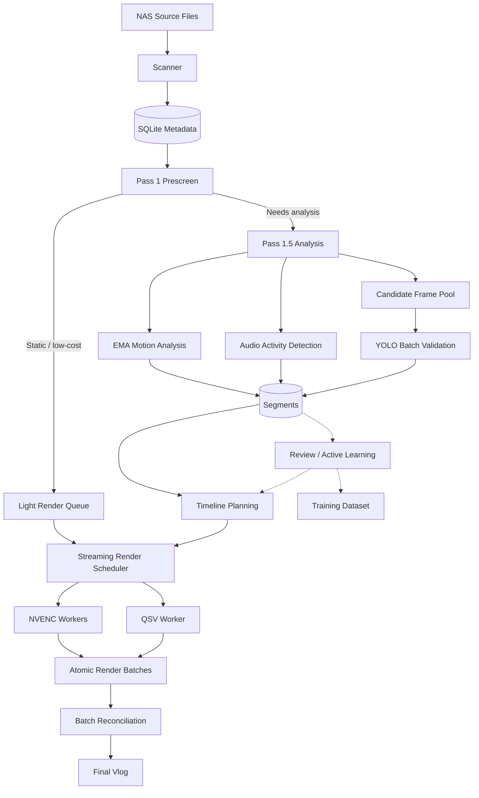

# HomeVlog Architecture

本文档描述 HomeVlog **当前有效的系统架构、数据契约、模块边界与关键运行时不变量**。

它回答：

> 系统现在如何工作，以及哪些架构约束不能被局部修改破坏。

历史架构决策与演进原因记录于：

```text
docs/DECISIONS.md
```

测试策略、质量验收准则与硬件隔离测试记录于：

```text
docs/TESTING.md
```

当前交付状态与已知问题记录于（性能实测统一见BENCHMARK，交付检查见ACCEPTANCE）：

```text
docs/PROGRESS.md
```

---

# 1. Architecture Principles

HomeVlog 面向长时间家庭监控素材，将全天录像分析、筛选并浓缩为可观看的 Vlog。

架构设计遵循以下核心原则。

## 1.1 Single-Pass Decode

同一阶段内应尽可能复用一次解码产生的数据，避免为运动分析、YOLO 验证等消费者重复执行完整视频解码。

新的分析消费者优先接入现有分析数据流，而不是独立重新读取和解码源媒体。

---

## 1.2 In-Memory Intermediate Data

分析阶段产生的候选帧优先以内存压缩表示流转。

当前候选帧采用 JPEG bytes 形式保存在受限内存池中，并直接供后续 YOLO 批推理消费。

除最终产物、持久化审核代表帧及事务性渲染批次外，不应依赖零碎临时图片作为流水线阶段间接口。

---

## 1.3 Fault-Tolerant Processing

NAS 网络抖动、源视频损坏、Seek 失败和提前 EOF 均属于预期运行条件。

局部失败原则上应：

```text
detect
→ record diagnostics
→ isolate failed unit
→ degrade or skip safely
→ continue pipeline
```

但任何可能破坏以下性质的异常不得静默忽略：

- 时间轴完整性；
- 批次完整性；
- 最终输出可播放性；
- 数据库状态一致性。

---

## 1.4 Deterministic Output

分析结果、展示时长、字幕、渲染批次和最终输出必须能够从相同输入状态确定性重建。

系统不得依赖未持久化的隐式会话状态决定最终时间轴。

---

## 1.5 Resumable Execution

长时间任务应以可验证、可恢复的工作单元推进。

渲染批次是独立事务单元：

```text
render temporary output
→ validate
→ atomic promote
→ persist completion
```

有效批次在普通重启或清理流程中不得被删除。

---

# 2. System Pipeline



整个流程可以划分为五个逻辑阶段：

1. Discovery & Metadata
2. Prescreen
3. Analysis
4. Timeline Planning
5. Rendering & Finalization

启动在加载运行环境前输出提示，初始化后显示本次运行日志路径。扫描目录开始、结束及每 10 秒等待心跳可见于控制台和文件日志；心跳标识当前目录检查、枚举、属性读取或入库操作。仅进度报告在线程中运行，NAS/SQLite 工作仍同步执行；报告线程在扫描成功、异常或取消时收尾。它不为系统调用提供超时或取消保证。

输入目录不可用、目录枚举或文件属性读取异常时，扫描记录上下文并停止本轮流水线，禁止在发现范围不完整时继续交付。已提交入库记录保留，目录恢复后可增量续扫。冻结边界的文件稳定性二次检查仍沿用暂缓入库规则。未启用冻结检查时不读取无用文件属性，也不增加媒体探测。

---

# 3. Persistent Data Model

系统持久状态统一存储于：

```text
data/vlog.db
```

SQLite 运行于 WAL 模式，并配置连接与锁等待策略以支持多 Worker 并发访问。

数据库是跨进程、跨会话状态的主要持久化来源。

---

## 3.1 `file_tasks`

记录源媒体级任务状态。

主要职责包括：

- 文件路径；
- 摄像头身份；
- 日期和文件起始时间；
- 媒体时长；
- Prescreen 状态；
- Analysis 状态；
- Processing Fingerprint。

### Metadata Contract

Scanner 只负责低成本文件发现与可直接从路径或文件系统获得的信息。

`src/scanner.py` 不负责昂贵的媒体探测。

媒体时长等需要解码或媒体解析才能获得的信息，应在后续分析阶段懒加载并持久化。

---

## 3.2 `segments`

记录源媒体内部的时间区间及其语义。

典型字段包括：

```text
start_time
end_time
state
max_energy
avg_confidence
manual_label
review_reason
```

核心状态包括：

```text
STATIC
DYNAMIC
DYNAMIC_AUDIO
```

Timeline 层消费 `segments`，而不是重新执行运动分析。

---

## 3.3 Human Review State

人工判断属于独立持久事实，不应因为算法重新分析而丢失。

算法结果可以失效和重新生成，但人工反馈必须跨重新分析保留。

Timeline 重建时：

```text
human decision > algorithmic decision
```

---

## 3.4 Camera Registry

`camera_registry` 维护：

```text
physical MAC
↕
logical camera index
↕
semantic alias
```

所有输出文件命名必须通过统一的命名解析逻辑完成。

禁止不同子系统自行复制输出文件命名规则。

---

# 4. Processing Fingerprint

`processing_fingerprint` 用于判断已有分析结果是否仍然适用于当前输入和配置。

Fingerprint 应覆盖会影响分析语义的输入，例如：

- source file size；
- source mtime；
- detection parameters；
- VAD configuration；
- segmentation parameters；
- model / weights version。

Fingerprint 改变时，可以失效算法生成的数据。

人工事实不得被自动失效。

---

# 5. Prescreen Architecture

Prescreen 的职责是以远低于完整分析的成本完成第一阶段筛选。

目标是：

```text
obviously static
        ↓
avoid expensive analysis

possibly meaningful
        ↓
full multimodal analysis
```

Prescreen 不应承担最终语义判断。

关键帧负判定必须覆盖已解码的最后一个关键帧；稀疏步长不能让文件尾部未经检查就判为 `STATIC`。该检查复用现有阈值与空间集中度规则，只有可疑文件才进入完整分析。

邻域保护消费按源时间排序的前段最终粗筛状态，不能将尚未完成视为静态（ADR0056）。已知前段状态沿用原早停；未知时关键帧单次解码保留基础/邻域两份小型判定，释放I/O许可后等待并选择，随后执行音频门禁并发布最终状态。失败和取消也唤醒后段；等待不持有媒体/硬件租约。非关键帧及关键帧失败后的seek路径在媒体读取前解析前段状态，可能降低这些模式的并发，不声称性能等价。分析指纹v5隔离旧顺序依赖结果，已COMPLETED日期仍由完成门禁优先跳过。

---

## 5.1 Low-Light Noise Handling

低照度环境中，红外噪点可能产生大面积随机差分。

Prescreen 使用空间能量分布而不仅是全局平均差分判断运动。

当前实现包含：

- spatial concentration filtering；
- local high-energy wake-up path；
- low-light-specific thresholds。

设计要求：

> 抑制弥漫性随机噪声时，不得依赖单纯提高全局运动阈值而显著降低真实小目标召回。

具体参数属于配置和实现细节，不作为架构契约。

---

# 6. Analysis Architecture

需要进一步判断的素材进入 Analysis Pipeline。

核心数据路径为：

```text
decoded grayscale frame
        │
        ├── EMA background model
        │
        ├── SpatialGrid
        │
        ├── AudioEnergyVAD
        │
        └── Candidate Frame Pool
                 ↓
             YOLO batch
```

---

## 6.1 Grayscale Analysis Contract

运动分析管道使用单通道灰度帧。

输出尺寸契约为：

```text
width × height
```

而不是：

```text
width × height × 3
```

不要在 FFmpeg / decoder 输出 RGB/BGR 后再执行 CPU 灰度转换，除非新的实现经过明确基准验证并更新相关架构决策。

阈值算法的规范输入是 8 位全范围灰度。只有 PyAV `gray` 帧可直接读取平面；limited-range YUV、10 位 YUV 和 RGB 必须经共享 `video_frame_to_gray()` 转换，Prescreen 与 Analysis 不得维护不同的像素解释。

scanner 写入的文件名跨度只是名义时长。只有实际打开媒体容器后才可设置 `duration_verified=1`；未验证时长不能用于跳过媒体探测。

稠密渲染输入已重采样至输出 FPS 时，亚帧级活动源区间的视频 trim 至少覆盖一帧周期，防止两个边界量化为同一时刻而产生空段。音频和源时映射维持原区间，最终帧数仍由共享展示计划决定（ADR 0031）。

未完成日期在重试前检查待处理、失败及此前跳过的素材。仅实际 stat 确认的普通零字节文件可记为 `SKIPPED_EMPTY`，打印含文件名和缺失时段的警告；该状态不消耗渲染批次、不生成静态占位画面，并在成片 `.meta.json` 的 `skipped_sources` 中记录。路径不可访问、文件不存在或非空损坏均不得归入空文件。重试时原空文件若恢复为非空则重新预筛；若不可访问则恢复失败。已交付日期仍遵循 ADR 0028，需显式重做才重新检查（ADR 0029）。

---

## 6.2 Candidate Frame Pool

只有满足候选条件的帧进入 YOLO 验证。

候选帧：

1. 在内存中压缩；
2. 受内存预算限制；
3. 批量送入 YOLO；
4. 不通过中间临时图片文件交换。

验证遍历动态候选区间内全部已缓存采样帧，不再对整个长区间另抽 8 帧。每个局部证据窗口至多包含 8 个缓存候选，按相邻帧时间中点切分，推理 microbatch 仍受 `yolo.batch_size` 限制；总缓存仍受解码器帧数/字节预算约束。这不代表逐帧检测，长文件的降采样间隔仍有盲区。失败、模型不可用或证据不足的动态片段在短段平滑和活动细化后保留保守常速及审核标记（ADR 0030）。

---

## 6.3 Adaptive Analysis FPS

分析实际 FPS 可以根据素材长度或运行时策略动态调整。

依赖帧序号进行后续采样或验证的代码必须使用解码器实际采用的：

```text
effective_fps
```

不得假设静态配置值等于实际分析帧率。

---

## 6.4 Analysis Scheduling

单文件渲染批次时，Analysis Queue 按 `file_duration` 短作业优先，已就绪文件可立即渲染，最终按固定录制序号拼接。多文件批次时按 `file_start_time` 排序，保持组批的录制顺序。

架构目标不是简单缩短单个分析任务，而是降低整个 Pipeline 的 downstream starvation。

---

# 7. Hardware Resource Model

HomeVlog 同时利用：

```text
RTX 3060 Ti
├── NVENC
└── NVDEC

Intel UHD 770
└── QSV

NAS
└── shared I/O budget
```

这些资源由统一 Scheduler 管理。

业务模块不得自行创建另一套独立硬件并发控制体系。

---

# 8. Scheduler and Concurrency

主要调度入口位于：

```text
src.scheduler
```

---

## 8.1 Resource Semaphores

当前资源模型包括：

```text
NVENC semaphore
NVDEC semaphore
QSV semaphore (Analysis)
QSV render semaphore (Render Worker Exclusive)
Disk I/O semaphore
```

NVENC 与 NVDEC 被视为独立硬件资源，不再通过单一 NV semaphore 串行化。

QSV资源实行阶段间独立许可预算（ADR 0014）：
- `get_qsv_render_semaphore()`: 读取`max_qsv_render_concurrency`，默认1，专供QSV渲染Worker；
- `get_qsv_semaphore()`: 读取`max_qsv_analysis_concurrency`，默认`max(1, max_qsv_concurrency - 1)`。配置校验两阶段预算总和不超total；这不是保证无硬件竞争或无排队的物理槽位认证。

`get_nv_semaphore()` 仅承担兼容性职责，不应作为新的通用 NV 资源模型继续扩展。

具体并发数量属于当前硬件配置，应由配置与 Benchmark 共同决定，而不是在业务代码中重复硬编码。

---

## 8.2 Semaphore Ownership

获得信号量的代码拥有归还责任；正常完成或确认停止后归还，未知终态须把同一proc/原许可/读线程转交Registry，确认后恰好一次回收（ADR0062/0065/0066/0067）。

释放必须具有 exactly-once 语义。

仅适用于同步工作或已确认子进程/线程终态的标准模式：

```python
acquire()
try:
    ...
finally:
    release()
```

禁止：

```text
release before return
+
release again in finally
```

因为这会破坏并发计数并最终导致资源门限失效。

---

## 8.3 Work Stealing

渲染任务按实际渲染成本进行异构调度。

主要目标：

```text
NVENC → heavy work
QSV   → light / moderate work
```

Scheduler 可以根据：

- queue depth；
- estimated dynamic duration；
- active analysis load；
- remaining tail work；

动态决定 QSV 是否窃取任务。

具体阈值属于调优参数，不构成永久架构契约。

当前队列权重是全部活动状态的**源时长**，包括驻留、夜间和微动；缓存恢复与新分析使用同一集合。它仍是代理指标，并非实测渲染成本。render 遥测分别记录 `queue_active_source_duration_s`（入队依据）、`active_source_duration_s`（实际时间轴）、`normal_speed_duration_s`（仅 DYNAMIC/DYNAMIC_AUDIO）和 `source_duration_s`。旧 `dynamic_duration_s` 保持常速时长语义兼容。QSV 的后置常速时长复核仍与入队权重不同，不能据旧字段推算其拒收原因。

---

## 8.4 Tail Guard & Dynamic Steal Balancing

临近任务结束时，应避免较慢 Worker 接手可能形成长尾的任务，同时杜绝过早退出导致尾部饥饿。

Tail Guard 遵循自适应平衡原则：
- **退出守卫**：所有源派发完成后，重队列为空或排队任务数不超过活跃NV数时，QSV停止领取重批次；
- **准入门限**：派发完成前沿用配置上限（当前420秒）；之后为配置上限、180秒和NV剩余ETA的0.8倍三者最小值。成本是队列活动源时长，包含夜间/存在状态，并非仅常速动态展示时长；
- **线程复用（ADR0072）**：异构两NV/一QSV编队在配置NV预算至少3、所有源已派发、最轻剩余批次严格超过QSV最大收尾准入，且现有显存探针取得低于水位的有效非负有限值时，允许原QSV线程结束自己的统计后进入现有NV循环。水位过高、探针缺失或失败时继续原两NV处理，并在后续循环重新检查；不取消在途任务。保留末尾硬保护、三线程总数和原资源租约。当前默认预算2；历史分析重建的三路收益未覆盖新分析显存边界，默认推广已暂停。该探针是准入快照，不构成额外显存租约或后续峰值保证。

其目标是最小化：

```text
makespan
```

是否改善收尾由同条件完整墙钟验证，不从局部占用率或成本估计推导同步收尾精度。

---

# 9. FFmpeg Process Lifecycle

跨日期准入（ADR0068）：require_cleanups在现有Registry锁内复用原生证据回收；deferred或尚未交回的启动认领仍存在时拒绝新流水线并保留中断。reset_interrupted在同一锁内完成该核对后才清中断，构造器在调度器/UI创建前调用；公开process_date_cam在认领/交付恢复/业务改写前核对，无待恢复包的历史COMPLETED保留纯只读跳过。批量入口在临时清理/扫描前核对；CLI重析、清理、配置重载与会写任务的dry-run也先核对。streaming/render/concat/companion的MediaTerminationUnconfirmed必须保留类型到跨组循环，记录失败异常不得掩盖它；当前组计失败、后续组保留remaining，已可回收也不继续本轮。普通失败仍可继续。确认回收后显式新执行才可恢复；未知读者可能占用的candidate保留，旧正式包不改。

回收锁顺序：Registry持锁归还原FileBudget时，等待者不得反向持budget.condition查询Registry取消标记。FileBudget在condition外核对取消，票据/加权余量/等待通知仍在原condition内维护；取消/超时移除原票据，不增加调度器、预算或后台线程。

concat未知停止时原位置保留ffconcat清单及临时MP4，不移动到诊断目录、不删除，避免破坏仍使用的文件或让PermissionError覆盖致命类型；timings记录终态与保留路径。新concat在改写清单前通过同一require_cleanups门禁。确认终态的普通失败与取消继续保留原有有界诊断/清理行为。

启动失败交接（ADR0067）：Registry用现有锁认领同key创建/登记窗口，保留实际proc的认领身份，既有owner或另一启动者先于创建拒绝。登记失败的清理也须核对内核终态；未知以MediaStartTerminationUnconfirmed携带proc/key返回原租约持有者，Registry保存proc/Job。五入口不能因start没有正常返回就把proc当不存在；接回上下文后按既有延迟清理合同保留原许可。deregister可校验实际proc，普通创建失败的None分支不按同名key解除其他owner；renderer已占用输出在写入前拒绝，启动未知仍保留临时资产、阻止备用/重试。启动认领不是硬件调度器或上游日任务/工作区/输出持久认领的替代，不覆盖未复现的Popen构造中途故障。

批次渲染终态合同（ADR0065）：Registry.has_exited在Windows真实句柄上核对内核结束信号，延迟回收不能只信缓存退出码；wait_for_exit在同一5秒预算核对内核/Popen等待。renderer正常和异常均按任务键停止/核对拥有Job后解除追踪；未知时转交同一VideoLease（硬件及加权disk），保留临时媒体/滤镜/虚拟输入，以RenderTerminationUnconfirmed阻止备用路径与硬件重试。同输出在准入回收后仍pending时，先于资产修改/启动拒绝。主流程归入render batch失败门禁并停止新工作，保留已成批次，不拼接/COMPLETED；审核FAILED保留旧交付。只有正常wait完成可发布，Job终止返回0不能把超时残片当正常完成。reaper不盲删保留资产，后续确认后同输出可重新准备；源读者的补充合同见ADR0066。不认证真实NAS驱动/物理断电。

直接源读者合同（ADR0066）：run_ffmpeg/run_ffprobe、prescreen及detector清理未知时抛MediaTerminationUnconfirmed，RenderTerminationUnconfirmed继承此公共类型。保留同一进程、原VideoLease或disk许可及仍活的读线程；退出检查不能以缓存0替代内核终态，detector看门狗也须据实际终态决定停止。run_ffmpeg最终清理统一核对stderr读线程，避免内层异常跳过join后释放。run_ffmpeg可选io_lease接收尚未取得的现有调度租约，由它负责准入/归还/延迟转交；调用方不可另行取得或finally归还。_extract_frame借此统一持有硬件及disk，不增加调度器。

未知停止不得触发PyAV第二解码、keyframes的seek备用、音频静默降级或prescreen音频门禁的保守再分析。pipeline先设置abort/stop与致命错误并请求停止，再尝试持久化FAILED；持久化失败另记错误，不撤销停止，也不拼接或交付。已有并发工作受同一全局取消治理，不宣称执行中原生I/O立刻退场。普通媒体失败在确认清理后仍沿原容错路径处理；单次wait/join预算不是整个NAS调用硬截止。

未确认清理转交Registry._deferred（ADR0062），保存同一proc、原I/O许可对象及管道读线程，阻止直接deregister遗忘。kill_all保留这些进程引用；reset_interrupted只准沿同一reaper回收已确认许可，不得解除pending（ADR0068）。reap_cleanups不等待、不重试停止、不重置取消标记；仅当同一Popen已确认终态、Job已关闭且所有记录的读线程退场时，关闭管道并恰好一次归还原许可，再移除记录。run_ffmpeg/run_ffprobe在I/O准入前调用；维护代码可显式核对。活进程、仍开放Job、活线程或关闭/许可释放错误保持pending并保留上下文，开放Job须先显式成功停止；不能reset_semaphores替代恢复。CPython Windows stdout_thread/stderr_thread是新增版本兼容验证边界，实际故障恢复测试必须保护该合同；不存在跨进程持久化许可恢复或真实SMB硬停止认证。

元数据探测run_ffprobe也通过Registry.start创建与登记，复用相同Windows创建时Job和现有disk准入。成功JSON、非零/空输出/非法JSON返回None、TimeoutExpired及启动异常传播保持；标准输入DEVNULL，不新增并发预算。通信异常时按Registry.terminate(key)停止本次拥有树，即使直接父已退出，也须关闭其Windows Job以结束持有管道的后代；退出等待5秒、异常后的communicate回收另5秒，再关闭管道/解除追踪/释放disk许可。未确认退出或管道回收时保留Registry与许可并报错，避免继续叠加源读者。执行超时不包含准入和退出清理，不认证SMB驱动硬截止。此保守隔离分支需要停止并核查旧读者后恢复，不能只reset调度器继续；普通确认终态释放恰好一次（ADR0061）。

run_ffmpeg普通捕获及stdout_consumer定时取消也按任务键停止拥有树，不调用全局kill_all、不设置全局interrupted。普通捕获超时后的communicate回收显式5秒；流式stderr线程join另5秒，线程未退场不阻塞关闭其管道，保留引用/许可并报错。异常退出清理等待5秒，未确认终止不解除追踪/归还许可。per-key terminate只发起停止并保留引用，完成确认及deregister由调用方负责；Job关闭请求不是SMB驱动内核终止认证。其他直接Popen入口的局部kill不由本单元自动获得该新清理合同，非Windows仍仅直接子停止与有界回收，不认证后代树终止。

所有长时间运行的 FFmpeg `Popen` 子进程必须受到统一生命周期管理。

使用：

```text
FFmpegProcessRegistry
```

完成：

```text
FFmpegProcessRegistry.start (create with ownership)
→ register (adopt existing ownership)
→ run
→ confirm process / Job / reader-thread terminal state
→ deregister and return original lease
  OR retain ownership / defer cleanup / propagate typed fatal error
```

Ctrl+C 或全局终止时：

```text
kill_all()
```

停止请求须覆盖拥有的FFmpeg进程树，并核对终态。未确认时保留Job/进程/原许可及必要输入，拒绝新组/备用/重试；不能承诺SMB驱动内核调用或GPU会话立即退场。

不得创建绕过 Registry 的后台 FFmpeg Worker。

已注册真实Windows FFmpeg复用process_lock.OwnedProcessJob（ADR0059）；元数据读者的_SourceJob为兼容别名。注册到deregister期间的父死亡终止Job成员；创建/分配失败必须停止新子并报错，只有短命令已完成的内核终态可跳过分配。deregister保留解除追踪而不杀活进程的合同，失败保留拥有引用；kill_all关闭Job并记录失败。此保护不覆盖注册前窗口、非Windows父死亡、SMB驱动硬阻塞或物理断电，常规调用仍应在完成后解除追踪。

ADR0060补齐四个媒体入口的创建/注册窗口：run_ffmpeg、detector、prescreen及renderer统一通过Registry.start。真实Windows启动复用OwnedProcessJob.create_process的PROC_THREAD_ATTRIBUTE_JOB_LIST，内核创建时建立归属，Registry只接收同一个Job；直接register已有外部Popen仍保留ADR0059范围。_OwnedFFmpegPopen仅替换CPython私有Windows创建钩子，复用其管道/communicate/wait/poll/kill；该签名须在Python升级时重新验收。媒体调用要求shell=False/close_fds=True，仅显式标准句柄白名单可继承，不全局修改_winapi或为主进程分配Job。创建/登记失败须尝试停止并核对；确认后清理，未知时由ADR0067携回实际proc/key，保留原Job/租约及追踪。非Windows及注入替身保持对应启动路径；不认证真实SMB硬终止或物理断电。

工作台帧图/短WebP预览复用run_ffmpeg及disk准入（ADR0057）。可选io_timeout约束一次I/O准入，默认调用仍用既有重试；预览最多等3秒许可，命令执行维持10/15秒超时。取消或非成功结果不得发布缓存候选。该准入/执行预算不覆盖调用前的源身份stat/resolve，不提供SMB内核硬截止保证。

工作台预览的前后身份读取使用inspect_source_identity_owned（ADR0058）：stat/resolve只在已有拥有读者内执行；本地恢复目录记录PID/创建身份，落盘后才开放源I/O，未确认退场时拒绝下一查询并隔离当前进程的disk许可。等待预算3秒包括目录认领、I/O准入与响应，退出清理另计；不由此认证整个请求、FFmpeg系统调用或其他NAS路径的硬截止。

---

# 10. Timeline Architecture

Timeline 层负责把分析得到的源时间区间转换为最终展示时间轴。

Timeline 不负责重新分析视频内容。

---

## 10.1 Display Plan as Single Source of Truth

`TimelineSegment` 保留分析侧的 `max_energy` 与 `avg_confidence`，供高光元数据消费；它们不参与展示时钟或滤镜选择。裁剪后合并相邻同状态段时，能量取最大值，置信度按保留区间时长加权。人工审核产生的状态不应伪造模型置信度。

展示计划显式接收输出帧率，每段目标向上量化到整数帧。视频 `trim=end_frame` 与音频目标同钟；字幕、高光、批次校验均传入相同 fps。每段最多增加不足一帧的尾部展示时间，避免音视频 concat 按较长轨道推进产生未计入计划的累积偏差。

合法源区间不因短于 0.1 秒而扩展，也不把人工审核边界延伸到 EOF 之外。最小输出帧数属于展示计划；视频采样至少一帧的保护不修改源时间映射（ADR 0035）。

音频按目标样本数 `atrim=end_sample` 闭合，不能仅按源 PTS 时长截断后重排时间戳，否则摄像机重叠 PTS 会留下多余样本。最终 ffconcat 使用每批视频 duration；视频保持 stream copy，音频重新对齐 PTS 后编码，避免 AAC 延迟/尾部填充制造视频接缝空洞与音频 DTS 回退。

展示计划唯一权威入口：

```text
timeline.compute_display_plans()
```

配置驱动的字幕、元数据和渲染时长校验通过 `display_plan_options()` 统一装配参数；渲染调用保留显式 segment/output 参数的优先级。滤镜生成的显式参数接口继续保留。

以下模块必须消费同一份 Display Plan：

```text
Render filter generation
SRT generation
Wall-clock mapping
```

不得分别实现自己的展示时长计算。

流式批次与伴随资产均使用 `build_timeline_from_rows(..., resolve_presence=False)`：按文件独立构造，保留人工纠正，不重新进行跨文件 presence 分类/合并。伴随资产生成只读数据库。重叠区间归一化由 timeline 共用实现按文件独立处理；变速过渡不跨源文件边界，避免批次大小影响展示计划。

成片映射绑定计划fps而非容器平均fps：复用disk预算遍历视频访问单元，PTS排序处理B帧，数量必须等于计划帧数，所有PTS必须落在计划整数帧网格（最多一个time_base tick舍入、原点最多一帧）。媒体大小/mtime验证前后不变才发布身份；mapping.fps与media_identity.fps相等。该过程只读取封装包，不解码画面，不替代完整A/V/画质验收；无法对应一包一帧的封装布局拒绝绑定。旧交付查询可返回不可用映射；新交付必须AVAILABLE才生成字幕/元数据，否则沿已有失败路径阻止正式发布及COMPLETED，保留旧资产及有效批次（ADR0054）。

---

## 10.2 Human Override

时间轴生成时，人工标签优先于算法判定。

例如：

```text
FP
→ force static

FN
→ force dynamic
```

人工纠正必须能够在重新运行 Timeline 时稳定复现。

---

## 10.3 Source / Display Time Mapping

系统同时存在：

```text
source timeline
display timeline
wall-clock timeline
```

三者不能混用。

从最终展示时间反查源视频位置必须通过统一逆映射：

```text
src_offset_at_display()
```

字幕真实时间也应通过同一映射体系生成。

---

## 10.4 Timeline Closure

每个源视频分析形成的时间范围必须完整覆盖预期媒体范围。

最后一个分析边界必须闭合到：

```text
start_offset + file_duration
```

以避免：

- timeline holes；
- missing frames；
- subtitle discontinuity；
- render gaps。

---

## 10.5 Dual-Track Timestamp Mapping Contract

系统跨模块消费时间时，必须严格遵守绝对时间、文件相对时间与墙钟时刻的双轨换算契约：

| 维度 | 字段名称 | 物理基准点 | 典型取值 | 业务消费场景 |
| :--- | :--- | :--- | :--- | :--- |
| **日内绝对时间** | `start_time` / `end_time` | 当天 `00:00:00` 起算的绝对秒数 | `65373.5s` (折合 18:09:33.5) | 24小时全局时间轴排序、拼接剪辑 (`concat`)、跨视频全局去重。 |
| **文件相对时间** | `local_t` | 单个物理文件 `0.0s` 起算的时间 | `259.5s` | 所有针对单文件的 FFmpeg 抽帧、PyAV 寻道、WebP 动图截取。 |
| **真实墙钟时间** | `clock_time` | 真实人类世界挂钟时分秒 | `18:09:33` | 界面刻度尺、标签徽标、SRT 字幕展示。 |

### 换算公式与寻道防御
$$\text{file\_offset} = \text{hour} \times 3600 + \text{min} \times 60 + \text{sec}$$
$$\text{local\_t} = \max\left(0.0, \min\left(\text{start\_time} - \text{file\_offset}, \text{file\_duration} - 0.1\right)\right)$$

寻道操作必须通过边界夹紧（Clamping）严格受控在媒体有效时长内，杜绝负向时间戳或末端溢出引发解码器挂起。

---

## 10.6 Five-Tier Adaptive Rate Contract (五级自适应阶梯浓缩模型)

为了根除将“有人静止陪伴”或“夜间睡眠微动作”粗暴当作纯静态抽帧丢弃导致的 P0 级严重漏检，同时避免成片被夜间熟睡过度膨胀（实测 62.3% 的驻留时间为夜间睡眠），系统确立了五级自适应浓缩契约：

| 状态标识 (`state`) | 播放倍速与呈现模式 | 触发与识别条件 | 适用场景与业务目标 |
| :--- | :--- | :--- | :--- |
| **`DYNAMIC`** / **`DYNAMIC_AUDIO`** | **1.0x 常速原画** (无损保全) | YOLO 置信度达标目标或音频能量触发 | 行走、抱起、走动互动、有声事件（核心高光） |
| **`PRESENCE`** | **4.0x 温和快进** (实体解码保留) | 白天两次活动事件间 $\le 180\text{s}$ 静止停顿，且具主体因果证据 | 家长看护坐定、静止陪伴、看书、看手机（防丢弃） |
| **`NIGHT_STATIONARY`** | **16.0x 高倍浓缩** (平滑变速过渡) | 夜间 23:00~07:00 睡眠静止或全天持续低能量 $\ge 180\text{s}$ 极低能量静止 | 夜间熟睡期、长时卧床休息（去虚胖，保留呼吸节奏） |
| **`MICRO_MOTION`** | **16.0x 巡航 + 3.0s 锚点** | 差分能量 $\ge 2.5$，YOLO 虽未框选但具有物理运动 | 夜间睡眠翻身、微弱手足活动、遮挡动作（事件保全） |
| **`STATIC`** | **55.0s 抽 1 帧** (幻灯片快进) | 差分能量 $< 2.5$，无人无声，深度睡眠静止 | 纯静态空房间背景、深夜平稳深度睡眠期（极限浓缩） |

### 跨文件时序因果链传递 (Cross-File Presence Propagation)
监控录像通常每 5~10 分钟切分为独立物理文件。若仅在单文件内检测，处于文件首尾的切片（如视频结束前坐定、下一段视频开头站立）会因边界截断被判定为静态丢弃。
因此，时间线构建必须在跨文件全局序列上执行 `resolve_presence_segments`，并在完成因果链状态传递后再通过 `split_segments_at_file_boundaries` 投影回各物理文件边界，确保 Virtual Concat 寻道绝对安全。

单文件稠密输入的活动时间轴含加速段时，可在原缩放、下载及抽帧链后，用一次 `select/setpts/fps` 代替逐片段的视频分支。平衡区间查找复现原 trim 的帧刻度、局部时间戳和共享展示计划的整数帧槽；音频仍复用原逐段处理链。仅适用于 CPU/CUDA passthrough、无稀疏映射、无渐变/OSD、无静态段且切片不重叠、不短于一个帧周期的输入，其余保留原图。该路径不改变解码、编码配置或硬件租约，见 ADR0042。

批次末端音频在重采样、补齐和计划样本数裁剪之后，以`asettb=1/<sample_rate>,asetpts=N`建立整数采样时钟；段内变速、淡入淡出和截取保持原规则。不得用浮点`N/SR/TB`重建末端时钟，以免长音频包出现一采样点舍入差异。

流式批次是例外：分析尚未完成时禁止执行跨文件 presence 重判，批次只使用已持久化的单文件分析状态，避免同一素材因邻居任务完成顺序不同而生成不同时间轴。跨文件 presence 仅在分析结果稳定后由全量时间轴构建路径执行。

### 渲染端活动实体集集合契约
```text
ACTIVE_STATES = {"DYNAMIC", "DYNAMIC_AUDIO", "PRESENCE", "NIGHT_STATIONARY", "MICRO_MOTION"}
```
所有属于 `ACTIVE_STATES` 的切片均进入实体音视频解码流，严禁将其作为静态抽帧忽略。

---

## 10.7 Filter Graph Duration Invariance and EOF Clamping (滤镜图时长硬截断不变量)

在非连续稀疏混合解码（`sparse_mixed`）或关键帧抽帧渲染模式下，输入视频流经 `select` 过滤器跳过了长时间静态区间。
此时，`trim=start=s:end=e` 滤镜在区间末端发射 EOF 时，其携带的流内 `eof_pts` 可能会直接跳跃至后续下一个被选中区间的起始时间戳。

**架构铁律**：
在 FFmpeg `concat=n=N:v=1:a=1` 滤镜图中，单段展示时长取 `max(video_duration, audio_duration)`。若非纯静态段后挂载 `fps` 滤镜，下游 `fps` 滤镜会依据外溢的跳跃 `eof_pts` 疯狂克隆末帧数十至数百次，导致批次实际展示时长严重超越计划时长并触发渲染丢弃。

因此，各段视频必须按展示计划截断到整数帧：
```text
tpad → fps → trim=end_frame={planned_frames} → setpts=PTS-STARTPTS
```
对应音频执行 `apad → atrim=end_sample` 到同一展示时钟。摄像头可能在最后一个计划切片之前就停止出帧，使该切片的 `trim` 结果为空；逐段 `tpad` 无法从空输入克隆帧。因此还需在每个输入的缩放/抽帧之后、`split` 之前补末帧，使所有计划切片都能取得视频帧。`concat` 输出再按 `compute_display_plans()` 的总帧数和样本数闭合。源文件完全没有可解码视频帧时仍应失败，不能发布缺画面成片。

---

# 11. Rendering Architecture

审核计划对比独立记录非静态事件保留和播放诊断：MICRO_MOTION/NIGHT_STATIONARY属于加速保留，不能一律算作整段遗漏。区间展示计量来自共享计划，部分重叠按比例分摊；清晰度仍须实片验证。审核标签库存不等于重放混淆矩阵，代表帧不自动认证整段或目标框真值（ADR0043）。

Rendering Pipeline 使用流式异构 Worker，而不是等待全天分析完全结束后再统一启动。

目标：

```text
analysis produces work
        ↓
render immediately consumes
```

从而让分析与渲染在可能情况下重叠。

---

## 11.1 Render Queue Model

任务根据成本大体分为：

```text
light work
heavy work
```

当前 Scheduler 使用双端任务获取策略：

```text
NVENC
→ prefer heaviest work

QSV
→ prefer static
→ otherwise steal lightest eligible work
```

任务成本应基于需要实际渲染的动态时长，而不是简单采用源文件总时长。

---

## 11.2 Worker Exit Semantics

`nv_retry_queue` 仅由 NV worker 消费：NV 批次失败至多重试一次，异构模式的 QSV 失败批次可转交 NV。`qsv_only` 模式没有 NV worker，失败必须记录为批次终态，不得放入该队列，以免阻塞收尾。

明确的外部中断（Windows `STATUS_CONTROL_C_EXIT` 的有符号/无符号退出码，或 FFmpeg 收到 SIGINT）由渲染器抛出 `RenderInterrupted`，在清理本批临时输出并释放租约后向调用方传播。主流水线设置 abort/stop 并通过现有进程注册表终止受管进程，保留有效批次；收尾后向主线程传播取消，记录 cancelled 遥测并以 130 退出，不执行 EDL 备用路径、硬件重试或最终交付。审核重渲染只将本任务设为 CANCELLED。普通编码异常保持既有有限重试，不根据 stderr 非空或 stop_event 推断中断者身份（ADR 0037）。

队列中的 sentinel 只承担 Worker 唤醒或状态传播用途。

Worker 不得因为单独读取到 sentinel 就立即退出。

退出必须同时满足：

```text
all work dispatched
AND
heavy queue empty
AND
light queue empty
```

否则可能遗漏另一队列中仍未消费的任务。

---

# 12. Atomic Render Batches

每个渲染批次首先写入临时文件：

```text
_batchX.tmp.mp4
```

完成后至少验证：

- process exit status；
- output existence；
- output size；
- required media validity checks。

验证成功后再执行原子替换：

```text
_batchX.tmp.mp4
        ↓
_batchX.mp4
```

只有正式批次可以进入最终合并流程。

---

# 13. Render Completion Barrier

“所有任务已经派发”不等价于“所有任务已经完成”。

StreamingOrchestrator 必须区分：

```text
dispatch complete
render complete
```

最终阶段必须等待所有渲染 Worker 完成，并执行批次对账。

核心不变量：

```text
dispatched batches
==
produced batches ∪ terminal batches
```

任何无法解释的缺失批次均属于完整性错误。

主动取消由 abort_event 明确区分，保存已完成批次与 cancelled 遥测，不将尚未完成批次报告为静默丢失；不得把 stop_event 当作取消，因为它也用于正常派发结束。

不得继续执行最终 merge。

---

## 13.1 Parallel Checkpoint Validation Contract

最终拼接阶段（`final_concat`）必须在产物原子重命名前验证每个批次连接处的解码完整性（`valid_video`）。

- **全量覆盖契约**：为杜绝异构编码在流切片接缝处出现不可观测的破损或丢帧，严禁在接缝处采用稀疏或随机抽样；
- **并行分块校验**：采用`ThreadPoolExecutor(max_workers=min(8, N))`将全部接缝窗口分块解码；各读者独立持有容器，按递增接缝位置seek。性能受解码、缓存及I/O共同影响，完整窗口通过不能外推未解码帧的无损认证。
- **容器生命周期（ADR0073）**：调用线程顺序打开独立读者，全部就绪后提交分块；工作线程只借用各自容器seek/解码。调用线程在池内所有工作结束后关闭读者，部分打开失败或线程池异常也须释放全部已打开容器。不得为规避打开等待而更改进程级PyAV日志回调。
- **读者解码线程**：保持PyAV默认策略。FRAME/2虽在旧成片局部对照有收益，但新生成成片的实际拼接路径出现原生校验等待，已撤回；现场及验证边界见BENCHMARK。
- **连续性契约**：串行与并行路径共用同一窗口校验，拒绝损坏帧、空 PTS、非单调 PTS 和超过 1.5 个帧周期的内部间隔；最终尾窗必须可解码。
- **打开失败回退**：仅独立校验容器的打开失败允许使用初始已打开容器重新串行验证全部接缝；回退前后文件身份必须一致。接缝解码、PTS 或连续性失败不回退为成功，容差不变。
- **交付契约**：渲染产物必须有音轨，视频/音频时长与 display plan 在最多两个输出帧周期（上限 0.5s）内一致。可打开容器不等于可提交产物。

最终拼接无论成功、失败或取消均记录 `final_concat`，包含状态、失败阶段及已发生的分项耗时。首次失败诊断保存于输出目录 `.concat_failures/<成片名>/`，保留拼接清单、截断至 64 KiB 的 stderr 和结构化报告；媒体总量上限 16 GiB、报告目录上限 32 个，每个成片仅保留首次失败，不覆盖旧证据。诊断达到预算后仍正常报错并保留输入批次；不自动清除既有诊断。该预算属于当前单进程流水线，不新增跨进程任务认领。

最终完成标记是一个提交边界：验证过的批次生成 `.pending.mp4`，候选字幕/元数据完成后才替换交付资产。`promote_vlog_assets()` 在原输出目录保留上一份视频、字幕、元数据及 manifest，调用方提交新 manifest 与成功状态后才移除备份。正常异常/取消恢复旧资产；回滚失败或进程骤停遗留的 `.delivery_backup_*/` 保留，`recovery.json` 标识原路径。新包另保存PREPARED/COMMITTED/RECOVERED事务身份并在认领下恢复（ADR0053），旧无事务身份包需显式检查。文件各自原子替换，不宣称跨文件原子性或物理断电保证。

主流水线只有 manifest 和数据库完成记录均成功才返回成功；实际数据库写入错误向上传播，关闭数据库时保留既有安全退出行为。审核重渲染使用相同资产提交边界，成功状态只属于审核任务，不改主交付记录。有效批次在完整提交前始终保留；`render.cleanup_batches_on_success` 默认 false，开启时仅清理本次批次及清单。

`COMPLETED` 代表历史成功交付，普通运行在配置指纹失效处理前直接跳过，不依赖产物仍在本地。发现待处理素材时提示；显式 `--force-render` 才绕过完成记录。重析包含已交付日期时也必须显式传入该参数，否则在重置前拒绝。未完成任务的恢复仍校验媒体与 manifest；备份移走产物后须保留 `data/vlog.db`（ADR 0028）。仅分析按源任务终态返回结果并保存遥测，不写交付完成记录。

---

# 14. Static Segment Fast Path

长纯静态区间不应按照普通动态视频执行完整逐帧渲染。

静态 Fast Path 应尽可能：

```text
select required frames
        ↓
scale / transfer
        ↓
encode
```

而不是：

```text
full decode
→ process every frame
→ discard most frames
```

这一路径是长时间监控视频压缩性能的关键优化之一。

具体触发阈值属于可调参数。

---

# 15. FFmpeg Filter Graph Safety

复杂时间区间可能生成过深的 FFmpeg `select` 表达式。

因此 filter expression 必须限制递归复杂度。

当前策略：

```text
time-range coalescing
        ↓
balanced expression construction
        ↓
complexity threshold
        ↓
fallback to full-frame decode
```

系统优先保证渲染成功，而不是无限追求稀疏解码优化。

---

# 16. Mixed Hardware Encoding

渲染可以同时使用：

```text
NVENC
QSV
```

批次最终通过 stream-copy 路径合并。

不同硬件编码产生的 HEVC 流必须满足最终容器与解码器兼容要求。

当前实现通过：

```text
consistent pixel format
+
in-band parameter-set injection
```

批次使用 `hev1` 保留带内参数集，避免 `hvc1` 封装剥离异构编码器重配置所需信息。最终原子提交前解码各拼接边界；失败不覆盖既有成片。边界检查不能替代全片解码与目标播放器验收。

QSV 以 `global_quality` 使用 ICQ，不混用 `maxrate/bufsize`。渲染接管素材时消费预取所有权；预取在已有源文件锁内复核，防止清理后迟到复制。

修改：

- codec；
- pixel format；
- encoder parameters；
- bitstream filter；
- final concat strategy；

任一项时，都必须重新验证跨硬件批次连续播放。

---

# 17. Human Event Review

当前闭环为分析 → 人工事件复核 → 持久区间覆盖 → 重渲/日常观看。训练、人工目标框、智能体目标建议、交互调参和基准管理已经退役（ADR0076）。模型检测仍属于生产分析，事件标签不自动变成目标框真值。

## 17.1 Review Data and Override Contract

人工审核结果必须保存在独立持久字段（如 `segments.manual_label` 与 `human_reviews` 表），而不是直接覆盖算法原始特征分析值。

撤销审核在同一数据库事务中清除当前切片投影并撤销其源区间内的持久标签。重分析改变边界后，交叉审核区间只移除交集，区间外标签/备注/归档引用保留；已存在的精确区间记录不被拆分记录覆盖。已归档图片不自动删除（ADR 0035）。

系统同时保留：
```text
algorithm predicted (algo_status, energy, confidence)
human corrected (manual_label, notes, review_timestamp)
```

时间轴重构时，遵循最高优先级覆盖法则：
- **`FALSE_ALARM` (FP) / `CONFIRMED_STATIC` (TN)**：在成片中强制降级为纯静态抽帧段，彻底滤除光影假阳性；
- **`MISSED_MOTION` (FN) / `CONFIRMED_MOTION` (TP)**：在成片中强制提升为常速动态段，挽救关键家庭瞬间。

---

## 17.2 Frame Archival

统一FrameArchiver保留审核代表帧与来源清单。优先源媒体，失败可使用当前区间内可追溯内存样本，须诊断；归档失败不应使事件审核丢失。归档不再提供训练或目标框导出。

## 17.5 Audit Service API Contract

审核工作台后台提供轻量 RESTful API 契约（`scripts/audit_tool/app.py`）：

- **`GET /api/overview`**：获取已审进度与显式标签库存；未指定独立生产重放时 Precision / Recall / F1 为 null。
- **`GET /api/anomalies`**：获取按类别（`fp_suspect`, `fn_suspect`, `jitter`, `reviewed`）过滤及能量排序的争议切片队列。
- **`GET /api/review_queue`**：读取完整segments库存及服务端范围计数，支持日期、机位（含0）、状态、显式场景、字面搜索、隐藏已审、limit≤200及offset分页；all为完整范围，旧anomalies语义保留。计数和页项处于同一只读事务，已有事务不提交。精选按同源5分钟/状态/场景分组，优先争议/能量代表并跨日期机位轮询；代表数量不提供隐藏成员ID，裁决仅影响实际复核项，不认证视觉相似。random按seed/id的BLAKE2b排序；同库存/范围/种子复现，变化后需重新记录页身份。未审全库不是独立负例真值。
- **`GET /api/delivery_comparison` / `GET /api/delivery_stream`**：按segment_id读取交付自带的全部状态/整数帧映射及已提交审核历史，返回覆盖源审核区间的完整展示分段，包含上下文；不按比例伪算源窗口帧范围。元数据绑定大小/mtime及已核验帧数/FPS，读取与播放分别验证；播放使用已打开文件句柄，版本变更返回409。旧交付无映射则不可定位，不能由当前审核/配置反推旧版本。
- **`GET /api/file_segments`**：获取单视频全量时序切片元数据及审核状态。
- **`GET /api/review_context`**：按已登记segment_id在只读事务中读取完整源分析/审核行，返回当前全局与机位解析值、全局显式值标记、场景/备注及共享展示计划上的分析/人工覆盖对比；不把计划当作渲染或准确度实测。已有调用方事务保留。
- **`GET /api/frame`**：单帧提取接口，支持 `w=640` 缩略图与 `w=1920` 超高清原画；源不可访问或抽取失败返回错误，不用占位图冒充源帧。
- **`POST /api/yolo_detect`**：按需对指定峰值时刻运行目标检测并返回边界框与置信度。
- **`POST /api/review`**：提交人工裁决，合法标签：`CONFIRMED_MOTION` (TP) | `FALSE_ALARM` (FP) | `MISSED_MOTION` (FN) | `CONFIRMED_STATIC` (TN)。
- **`GET /api/export`**：导出带 UTF-8 BOM 的分析报表（CSV / JSON 格式）。
- **`GET /api/rerender_plan`**：只读捕获日期/机位审核与有效配置快照，复用实际批次计划及缓存媒体校验，报告主路径预计展示时长、源文件、审核覆盖和可复用批次；不启动编码、不暂存原片、不覆盖已有EDL。
- **`POST /api/rerender` / `GET /api/rerender_status`**：异步重建日期/机位成片；可提交预览的expected_snapshot，审核/配置变化则拒绝启动。状态包含捕获的snapshot_sha256及实际逐批缓存决策、备用路径尝试和完成状态。
- **`GET /api/video_stream`**：基于 HTTP 206 Partial Content (Range Requests) 的流媒体成片在线预览分发。

服务仅接受 loopback Host 与同源 Origin。页面首次加载取得随机 `HttpOnly`、`SameSite=Strict` 令牌 cookie，所有写请求必须携带该令牌；媒体参数只允许数据库已登记路径或 `OUTPUT_DIR` 下的已渲染视频，并严格限制请求体及数值范围。

预览缓存绑定规范化完整源路径、大小、mtime_ns与实际FFmpeg寻道/分辨率参数；使用唯一临时文件，仅在成功、非空且源身份未变化后原子发布。旧缓存不删除、不复用；大小/mtime检查不宣称能识别保留同一stat的内容替换。动态帧/动图响应no-store，重新加载队列清除前端预取集合。短动图最多6秒、无声，不扩张短区间；完整复核入口使用队列明确的文件内区间，播放原片及声音，到区间终点附近暂停（受浏览器事件延迟影响，非逐帧裁剪）。关闭或切换审核项释放视频源；J/K仍切换审核项，播放器打开时禁止盲打标签，避免旧视频与新裁决错配。

审核重渲染要求全部必需源文件可访问；SKIPPED_EMPTY / SKIPPED_EXCLUDED / SKIPPED_CORRUPT 终态复用统一排除规则，不再探测或渲染，仍记录于伴随资产。未知源大小用 null，只有确认零字节才用 0。使用只读逐文件 timeline 与实际渲染行快照生成伴随资产。单任务取消只设置本任务令牌，不得触发全局 FFmpeg 中断。

审核行集合在数据库锁内的只读事务中捕获，已有调用方事务不被提交或回滚；分析行、审核行及伴随资产均使用捕获集合。预览是主路径当前可复用性，不保证执行期间源/缓存未变化或不会触发备用路径；实际执行再次校验，指纹还包含编码器/源stat/模型/完整配置，不能从审核条数推断失效原因。build_batch_render的inspect_only模式仅返回计划路径（不是完成媒体），cache_observer读取共享运行路径的决策；默认执行语义、租约及FFmpeg生命周期不变。当前审核仍使用既有配置编码器（默认NV），不会自动采用旧QSV批次的设备分配。

取消请求进入CANCELLING，当前批次结束后才进入CANCELLED；终态已写但旧线程仍存活时也拒绝同键新任务。提交资产和成功终态共用取消锁，提交完成后不再接受取消。状态返回深复制，前端读取错误不当作任务结束；只读预览及执行结果使用no-store。同进程线程保护沿用ADR0044；主流程与工作台的跨进程数据库/临时目录/输出认领见ADR0052，不能据此声明多资产断电原子性。


参数窗从当前配置初始化，只提交用户实际修改的全局字段，明确展示机位覆盖可能使值不变；不将初始值解释为推荐。expected_sha256校验预览配置版本。是否可复用同配置预测，要比较所有参考机位的完整有效配置，不能只比较展开后的全局字典；显式填入与全局默认相同的数值仍可能改变机位继承。ProductionReplayStore.measure在同一次收据校验中返回保留、展示详情与身份，避免为详情重复读取模型/源stat；两侧代码/模型/运行库/完整源集合身份不同则UNAVAILABLE。sample_changes报告每条冻结参考的保留、状态与比例展示贡献，并附两侧收据hash；缺失详情标为未测，不回填旧摘要。

解码完成必须有正常 EOF 或已确认的媒体解码错误后可用前缀；85%/完整帧覆盖不能覆盖非零进程退出、超时、中断、I/O或内存错误。PyAV只有 InvalidDataError/EOFError 可进入前缀保留路径。采样误差允许2个采样周期，超过则记录提前EOF。file_tasks.decode_completion 保留声明/可用时长、采样周期、完成原因和失败上下文，重析复用声明范围；伴随资产 unavailable_source_ranges 明确标识未交付尾段，其范围依据是媒体声明时长，不宣称这些时段曾实际录制。正常媒体不因不足一个采样周期而收缩源时间轴。

已知启发式生成的历史标签不能冒充人工覆盖；旧定向隔离工具已随基准管理退役。既有隔离记录和人工事实保持，本轮不执行数据修补或标签迁移。

伴随资产 source_duration_by_state_s 按全部时间轴状态统计源时长；完成卡分别显示动态、声音、有人驻留、微动、静态与夜间驻留，不能把仅动态/静态两项之和称为完整内容分布。

---

审核概览由get_review_inventory统计显式人工标签，Precision/Recall/F1保持null；不依赖调参模块。配置与归因只读显示有效配置和共享计划对比，人工审核持久化仍保留原合同。

# 18. Configuration Contract

`config/settings.yaml` 是用户可配置运行行为的入口之一。

配置路径与缓存由 `src.core.config` 单独持有。`src.utils` / `src.core.utils` 的旧名称动态读取核心状态，不保留缓存快照；旧入口的显式 `SETTINGS` / `CONFIG_PATH` 赋值在下一次旧入口加载时作为覆盖消费。覆盖应用与加载共用可重入锁，核心重载不会被旧快照回写。非法配置不替换有效缓存，显式和 wildcard 导入保持兼容（ADR 0033）。

配置必须满足：

```text
configuration
↕
runtime implementation
```

双向一致。

禁止存在：

```text
defined but unused key
```

或：

```text
runtime branch with undocumented configuration semantics
```

Preset / tier 等枚举配置必须具有明确的代码消费逻辑。

展开后的 ResolvedConfig 仍是字典，并携带未序列化的原始显式配置及展开快照；重新解析机位/预设时从显式来源重建默认值，保留展开后 CLI 等运行覆盖。优先级为机位 overrides > 全局专家显式值 > 经灵敏度缩放的机位预设。调用方把有效机位配置显式传给批次渲染、滤镜、校验指纹、字幕和元数据；不能在内部重新加载全局配置取代它。

工作台配置变更持有核心配置加载锁覆盖读/改/备份/原子替换/加载，使用唯一临时文件与不可覆盖备份；失败加载恢复旧文件和缓存。预览内容哈希改变时拒绝写回（HTTP409）。回滚使用同一边界。另按规范化配置路径持有同目录内核写者锁，覆盖读取、预览SHA校验、提交、加载及失败回滚；竞争请求返回ConfigurationConflict/HTTP409。锁文件残留不是占用，不在运行中删除。仅约束使用这些入口的本地主机写者，不保护绕过API的编辑器（ADR0069）。

---

# 19. Performance Measurement Contract

并行系统的性能指标评估必须遵守清晰的量纲与基线契约。

---

## 19.1 Worker Time vs Wall-clock Time

- **Worker Time**：所有 Worker 实际工作时长的累计值，用于定位各子系统 CPU/GPU 算力开销与负载分布。
- **Wall-clock Time**：用户从任务启动到成片交付实际等待的真实壁钟时间，是端到端优化的终极衡量依据。

性能报告仅将 `prescreen`、`analysis`、`render`、`final_concat` 四个主阶段相加。`render_enc` 是渲染内部的 FFmpeg 链路，`render_stage` 暂存可发生在后台或渲染调用内，均单列而不再叠加进主阶段总工时。主阶段工时/壁钟只描述任务重叠，不是硬件利用率。

`decode_time` 包含管道读取、同步逐帧运动计算及候选帧处理，不能当作纯解码时间；`render_enc` 包含解码、滤镜和编码。`final_concat.extra` 分别记录 `probe_s`、`ffmpeg_s`、`validation_s`、`promote_s`；FFmpeg 项包含音频对齐重编码和封装写盘，不可再与父阶段重复累计。

硬件监控按日期/机位增加`upstream_*`（等待粗筛和分析排空）、`render_tail_*`（上游排空后至渲染对账完成）及`final_concat_*`。前两项是外层`pipeline_*`的细分，`include_in_total=false`，监控摘要总时长不重复累加。它们仅观测既有阶段，不参与设备或队列决策。并行接缝校验在成功及失败路径均保留`checkpoint_chunks`：每个读者的打开、seek、解码、帧数及总耗时；预开读者的`total_s`为本读者打开与分块执行之和，不含等待其他读者打开或调用方关闭。这些读者累计值不等于校验墙钟。

---

## 19.2 Standard Hardware Baseline Environment

HomeVlog 的性能调优与资源限额锚定在标准生产硬件拓扑：

- **CPU**: Intel Core i5-12600K (6P + 4E, 16 线程全负载调度)
- **核显 (iGPU)**: Intel UHD Graphics 770 (双 Gen12 VDBox，专职 QSV 解码与动态批次反向工作窃取)
- **独显 (dGPU)**: NVIDIA GeForce RTX 3060Ti (8GB GDDR6，专职 YOLO 批推理与双路 NVENC 硬件编码)
- **输入介质**: NAS SMB 共享目录 / 本地 4K H.265 监控视频 (24 小时约 86,400s，日均 140~144 个 MP4，约 40GB~60GB)
- **运行环境**: Windows 11 (PowerShell 5.1+, Python 3.12, PyTorch CUDA 12.4, uv)

---

## 19.3 Measurement Evidence Routing

性能比较口径见[BENCHMARK.md](BENCHMARK.md)，不作为架构不变量。历史scratch证据已由用户移除，不将旧数字认证为当前可复验收益。

---

## 19.4 Hardware and Scheduling Boundaries

1. **GA104 单 NVDEC 引擎的并发硬顶**：
   RTX 3060Ti的NVDEC由分析与渲染共享。`max_nv_decoders`是工作负载相关并发预算；当前配置值不能被解释为适用于所有输入的物理上限或无饥饿保障，调整须固定识别输入验证整日壁钟。
2. **Intel UHD 770 异构窃取准入**：
   当前配置 `max_qsv_dynamic_duration_s: 420.0`，派发完成后的收紧及线程复用条件见8.4。它是调度策略，不是硬件物理边界；队列成本采用含夜间/存在状态的活动源时长。调整前须固定识别输入与展示计划验证整日收益。
3. **异步前瞻预分期 (Lookahead Pre-staging)**：
   后台预读取可与分析重叠，将后续素材提前暂存至本地SSD；是否覆盖渲染等待取决于缓存、源和调度，不能保证彻底消除SMB阻塞。

生产遥测与冻结性能基线见[BENCHMARK.md](BENCHMARK.md)；当前实施状态及缺口见[PROGRESS.md](PROGRESS.md)。

---

# 20. Architectural Change Boundary

以下修改默认属于架构变更：

- Pipeline stage 增删或职责变化；
- 数据库核心契约变化；
- PipelineTask 等跨阶段数据契约变化；
- Timeline semantics 变化；
- Scheduler resource model 变化；
- hardware concurrency ownership 变化；
- render batch transaction semantics 变化；
- retry / recovery semantics 变化；
- human feedback precedence 变化；
- cross-hardware concat strategy 变化。

发生这些变化时：

1. 修改实现；
2. 执行对应验证；
3. 更新本文档中的当前架构；
4. 在 `docs/DECISIONS.md` 记录设计决策与原因；
5. 如存在性能影响，在 `docs/PROGRESS.md` 更新基线结果与实测矩阵。

---

# 21. Architecture Invariant Checklist

修改核心流水线时至少检查以下不变量。

### Analysis

- 是否引入重复完整解码？
- 是否破坏灰度分析数据契约？
- YOLO 是否仍然使用实际 `effective_fps`？
- Metadata 是否仍保持 Lazy Loading？

### Scheduler

- 是否绕过统一 Scheduler？
- Semaphore 是否 exactly-once release？
- NVENC / NVDEC 是否仍独立调度？
- 新 Worker 是否可能造成硬件过量并发？

### Rendering

- FFmpeg 进程是否全部受 Registry 管理？
- Batch 是否仍然原子生成？
- Worker 是否可能提前退出？
- 最终批次是否执行物理对账？
- 中断后是否可以继续运行？

### Timeline

- Display Plan 是否仍然只有一个来源？
- 人工标签是否仍优先？
- Source / Display 时间映射是否保持一致？
- 时间轴末端是否完整闭合？

### Persistence

- 算法失效是否错误清除了人工事实？
- Config 与代码是否存在失配？
- 是否引入只存在于运行时内存中的关键跨会话状态？

---

# 22. Related Documents

```text
AGENTS.md
```

Agent 工作方式、任务生命周期与文档路由。

```text
docs/PROGRESS.md
```

当前项目状态、最新生产遥测基线 (Multi-Day Telemetry) 与已知问题。

```text
docs/DECISIONS.md
```

架构决策历史 (ADRs) 及其背景、替代方案和演进关系。

```text
docs/TESTING.md
```

测试策略、验证命令、硬件测试规范与质量验收基线。


交付映射与审核历史（ADR0047）：companion按partition_timeline_by_batches、normalize_file_timeline及compute_display_plans生成全部状态的连续整数帧范围，与实际容器帧数/FPS不符时仅映射UNAVAILABLE。审核promote_vlog_assets显式keep_previous=True，在成功提交后发布review_history.json，保留已迁移的旧包；失败/取消仍走原回滚，索引发布失败保留恢复目录并报告错误。历史不自动清理，普通流水线默认keep_previous=False。媒体大小/mtime身份不等于完整内容hash；不保证同stat替换或进程骤停/断电时的多文件原子性。


视觉索引与来源（ADR0048）：visual_features是独立于人工标签的可重建派生表，绑定segment_id及源路径/分段边界/offset、大小/mtime、时刻、描述子与采集方式；重分析删除旧派生行。正常MotionDetector复用现有gray帧，最多2,048个描述子，按分析采样时钟选择区间内代表，特征失败诊断后不改变分类结果。历史index_source只稀疏寻道，不另跑整片分析；单CPU线程与现有disk准入、源前后身份/分段布局核对、事务/savepoint发布，有效完整索引不再解码。历史补建的独立源读者生命周期及截止预算见ADR0051；正常分析、扫描和查询的直接NAS访问不因此获得硬截止保证。

review_queue新增visual类别和reference_id：256位灰度dHash距离占0.75、16档量化亮度分布L1距离占0.25，结果按距离/id排序；这是整体像素近似，不是人物识别、事件等价或置信概率。captured_index_items为范围内有效描述子捕获量，indexed_items为本筛选匹配量，页项再核对当前源身份；未知/失效项不补成负例。索引本身不写人工标签，不提供相似成员裁决ID。POST /api/index_visual_source限定已登记segment所属单源，复用当前索引或受控补建；批量补建经显式CLI范围和报告。

归档清单v2绑定源身份/图SHA/请求位置/时刻类型。唯一临时图只在成功非空且源未变时发布；不再按文件名借用任意磁盘缓存。内存兜底只选当前区间内已有解码样本，保留分析采样时刻，不能冒充当前源身份或原片逐帧PTS。v1图片/事件标签不自动成为可信图像或目标框真值。


流式`MotionTrace`不支持帧下标；正常分析的视觉描述子在消费灰度帧时按源预计采样量稀疏收集，最多2,048项，保持原运动标量计算和单次解码。只有当前源完成、源身份匹配并持久化最终分段后才发布派生索引；音频快速路径不使用复用detector的旧视觉样本。描述子仍为分析采样时钟，不能代替逐帧PTS或事件真值。


库存补建CLI（ADR0048/0051）：报告读取/原子保存由同目录内核写者锁保护并绑定数据库；历史完成须当前完整派生行可复用，缺帧记PARTIAL，错误记FAILED并非零退出。新源优先，已知同身份未完成显式重试；source-file限定原片，source-budget-s限定独立读者启动、源元数据及采样的累计壁钟。父进程持有现有disk准入，Windows Job在读者开始源I/O前绑定，父进程消失后终止读者；Linux使用父死亡信号（当前Windows验收，Linux未实测）。内存JSON只传描述子，读者不打开数据库或调用方应用入口。父进程超时/取消终止并等待读者，无法确认停止时终止整轮；发布前及事务结束前检查取消，失败回滚旧派生行。初始I/O准入和SQLite发布不计入源读取预算。RUNNING/active_source先持久化；骤停遗留RUNNING不证明进程仍活跃。目录锁不替代生产跨进程认领或另一报告目录写者保护。

独立读者管道收尾：后台stdout/stderr线程持有自己的Windows线程句柄；父进程关闭缓冲流前先请求取消这些线程的同步读取，并在共享2秒预算内等待。线程仍存活时抛出VisualReaderStopError并终止整轮，避免主线程等待缓冲流锁；子进程退出本身不证明读取线程已退出。该边界不保证所有NAS驱动请求立即取消，也不覆盖正常分析、扫描或工作台直接读取。

Windows终止确认另使用真实进程句柄等待内核结束信号（最多5秒），不依赖已缓存的Popen退出码/wait返回值。实际NAS源读取曾出现退出码0、进程对象未结束且原生read仍未收尾；无法确认内核结束时抛出VisualReaderStopError，整轮停止，不扩展新源。源预算不包含这5秒终止确认及2秒管道收尾预算；硬截止失败不代表驱动请求已经取消，后续恢复先核查旧读者终态。

同报告跨轮恢复在数据库打开前检查历史active_reader：源读者绑定Job后、发送原片路径前持久化PID与创建身份。匹配实例仍未结束时拒绝新的源准入；不存在、已结束或PID创建身份变化可继续，并在新尝试记录只读核查结果，不删除旧尝试。检查点发布失败先停止读者，不进行源读取。旧READER_STOP_FAILED缺身份拒绝自动猜测；遗留RUNNING本身不证明活跃。该门禁只覆盖同报告/本地主机，不替代跨报告/跨主机总预算、生产认领或正常分析/其他读者管理。

跨进程认领（ADR0052）：公开process_date_cam（含仅分析/force）及审核实际线程，持有数据库路径/日期/机位、整个TEMP_DIR与具体交付路径的内核锁直至收尾。共享临时目录的不同日期也互斥，以保护无日期隔离的暂存清理和进程内硬件预算；不同实验工作区仍须遵守已有测量并发约束。普通历史COMPLETED只读跳过保持。重析先认领工作区和全部所选数据库组，冲突零业务修改；临时清理认领同一工作区。固定顺序非阻塞取得，冲突显式失败，部分取得回收，进程骤停内核释放；锁文件残留不是状态。工作台取得锁后重新核对输入快照。多资产中断恢复遵循ADR0053；物理断电一致性仍未认证。

交付包恢复（ADR0053）：替换前transaction.json绑定输出/入口/日期机位、完整旧/新内容身份与manifest指纹；调用方manifest和状态提交后写COMMITTED。持有现有数据库/工作区/输出认领时，PREPARED包先全量校验，保留中断候选再原子复制旧资产；身份漂移、路径越界/链接、多个中断包或旧无内容身份包拒绝猜测。主流程恢复后写PENDING再RECOVERED，COMPLETED不能绕过未提交包；恢复期间再次中断可重复进入。已提交审核包历史标记缺失在下一次写入入口补建，读接口保持只读。恢复包不自动删除，完整hash/复制受现有I/O预算控制。当前只有实际进程骤停验收，物理断电和SQLite NORMAL持久性不由此保证。

维护入口边界：历史COMPLETED快捷返回前，以数据库保存的交付路径检查旧仅路径恢复包；相关包或无法解析的旧映射拒绝跳过，保留业务行与资产。正常离线交付仍可跳过，成功审核历史不误判为中断包（ADR0053）。诊断截帧复用run_ffmpeg与I/O准入，执行预算15秒、准入3秒；未确认停止原样传播，预算不涵盖外部文件系统调用。旧音频修复入口仅只读统计，旧阈值CLI不接受配置应用；不从局部事件阴性推断完整文件无活动。

补充ADR0069：显式源排除先认领同一数据库日期/机位，活动任务冲突时零修改并返回HTTP409。粗筛/分析写回以SQL条件保护SKIPPED_EXCLUDED，迟到分析不替换旧分段/视觉索引；最终时间轴仍跳过排除源。交付准备在.delivery_preparing_*中完成内容身份和完整transaction.json，再同目录重命名为.delivery_backup_*，此后才允许移动资产。准备异常清理当前目录；准备中骤停遗留目录不参与恢复，也不自动全局清理。已有旧恢复包的保守拒绝保持。

补充ADR0070与ADR0071：时间轴滤镜生成末端统一使用整数样本时钟（`asettb=1/<sr>,asetpts=N`），消除浮点PTS在一采样点上的舍入偏差；高分段批次通过`GroupedAudioPlan`以48段有界分组直接读取源输入，解除复杂滤镜图引起的CPU与GPU编码器空转争用。Pass 1.5 解码耗时通过独立非侵入工具度量，确立GPU显存内直接下采样的性能契约；交付流采用原子重命名，常规交付无物理大文件拷贝。


### 日常观看导出（ADR0075，选择依据由ADR0076收敛）

`scripts/audit_tool/watch_export.py`只消费已交付帧序列和冻结分析，不进入分析、重渲替换或训练流程。来源关联使用规范化完整路径及文件内区间重叠；analysis的start/end减file_start_offset，人工审核保留其文件内区间。每个父映射段保存完整去向和全部相交证据，混合人工负/正不提升为整段阳性。普通候选按半小时墙钟组轮询，优先项超预算返回BUDGET_CONFLICT。

preview/start绑定父媒体stat/帧钟原点、映射SHA、冻结分析/审核内容摘要、源stat及实际载入的exporter/FFmpeg实现SHA。源身份只代表路径、大小和mtime，不能检测保留相同stat的内容替换。父成片非零原点参与精确解码裁剪；每段视频整数帧闭合，音频48k整数样本时钟，临时段使用PCM，最终仅一次AAC编码。逐段包帧钟和最终完整AV解码均通过后，独立pending目录原子改名为不可变版本。

worker复用day_task_lease、VideoLease、受管FFmpeg；完整AV验证使用disk准入并finally归还。run_ffmpeg的可选cancel_event只终止该次调用拥有的进程树，不设置全局中断；未知停止仍沿原MediaTerminationUnconfirmed保留租约。日期任务/共享workspace/具体导出目标锁防止旁路硬件任务；不改render_tasks。取消/失败保留独立尝试目录，无完成发布。

工作台懒初始化受锁保护；清单完整分页、身份核验后Range流播放。冻结清单只读，不使用旧segment_id写裁决。原片回看使用冻结的通用源区间并核对绑定源stat，失联或变化拒绝；无历史实验附件适配。

日常选择policy为whole-delivery-segments-round-robin-v2，优先级仅来自当前持久human_reviews；不读取scratch、不复用固定实验案例、不新增历史观察库存。capture/manager接口没有scratch参数。当前实现SHA进入快照，旧快照不得作为新生成版本身份。共享replay_evidence/replay_journal仍提供交付恢复、哈希、原子JSON、租约和完整负载测量工具，不随调参入口删除。
